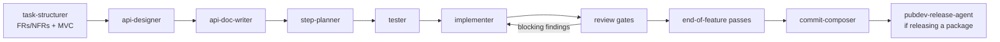

# Agents

My personal collection of Claude Code agents, skills and global prompts (`CLAUDE.md` / `AGENTS.md`), mostly for Dart/Flutter work. Not a package or an app: it's the source I keep these in and wire into my tools.

## What's here

```text
agents/
  orchestrator.md        Router that drives the whole pipeline
  New Feature/           Pipeline stages and reviewers for new work
  Existing Feature/      Backfill requirements / tests for untested code
  Bug Hunt/              Hypothesis → verification loop, regression-test backlog
skills/                  Reusable rules and procedures the agents (and I) load
prompts/AGENTS.md        My global instructions (scripting, git, MVC, Dart workflow)
```

`agents/.run-state/` (in-flight run state) and `skills/synced/` are git-ignored.

## How I work

Everything is built around the **Minimum Viable Change (MVC)**: the smallest change that makes the feature work or the bug go away, proven by tests. Anything beyond the request gets listed as an "unrequested extra" and asked about, never added by default. Bug fixes always come with a regression test.

## The pipeline

The `orchestrator` agent drives it, sizing the route by the MVC's budget.



- **Per-step review gates:** architecture-guardian, test-adequacy-reviewer, convention-agent, plus code-smell-detector, memory-safety-agent, duplicate-code-detector and sql-safety-agent when the diff calls for them.
- **End-of-feature passes:** dart-modernization-agent, coverage-auditor, sensitive-data-agent.
- **Cross-cutting:** gap-finder at every handoff, scope-arbiter for excess findings, engineering-balance-critic as a non-blocking counterpoint.

Other entry points:

| Situation | Agents |
| --- | --- |
| Code exists, no tests/requirements | `test-writer`, `requirements-analyst`, then join the main graph at review |
| Something is broken | `bug-hypothesis-former` → `bug-verifier` loop; confirmed bugs go to `regression-test-backlog.md` |
| One bounded task (add coverage, split a file) | Straight to the relevant agent(s), skipping requirements/contract/plan |

## Skills

| Area | Skills |
| --- | --- |
| Process | `minimum-viable-change`, `run-pipeline`, `resolve-project-conventions`, `place-project-knowledge`, `compose-commits` |
| Dart | `dart-edit-protocol`, `design-dart-class`, `edit-dart-class`, `comment-code`, `use-dart-analyzer` |
| Flutter | `flutter-conventions` (index over widgets, state, rebuilds, controllers, navigation, theming, async UI), `review-flutter-async-and-disposal`, `review-flutter-visual-changes` (live-app before/after check, run by `flutter visual reviewer`), `document-app-navigation` (notes in `.agents/screens-navigation/` on how to reach a screen) |
| Architecture | `layered-architecture` |
| Testing | `write-dart-tests` (with `test-case-matrix.md`), `write-flutter-ui-tests` (widget, golden, integration), `write-regression-test` |
| Docs & releases | `write-requirements`, `write-changelog-and-semver` |

## Adding things

- Agents are Markdown files with frontmatter (`name`, `description`, `tools`, `mode`, `permission`); skills are `SKILL.md` files with `name` and `description`.
- Before writing down a new rule, use `place-project-knowledge` to decide whether it belongs in `prompts/AGENTS.md`, a skill, a project's `docs/`, or its `specs/`.
