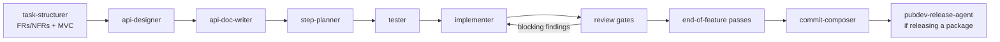

# Agents

My personal collection of Claude Code agents, skills and global prompts (`CLAUDE.md` / `AGENTS.md`), mostly for Dart/Flutter work. Not a package or an app: it's the source I keep these in and wire into my tools.

## What's here

```text
agents/
  orchestrator.md        Router that drives the whole pipeline
  New Feature/           Requirements, contract and plan stages, plus the checks between them
  Implementation/        implementer, tester, test-writer (used by every flow)
  Review/                Reviewers and end-of-feature passes (also run standalone)
  Release/               commit-composer, pubdev-release-agent
  Existing Feature/      Recover requirements for already-built code
  Bug Hunt/              Hypothesis → verification loop
skills/                  Reusable rules and procedures the agents (and I) load
prompts/AGENTS.md        My global instructions (scripting, git, MVC, Dart workflow)
plugin_builder/          Dart project that builds the cross-platform plugin package
plugin_builder/specs/    Design docs (e.g. cross-platform plugin packaging)
plugin.config.json       Build config for it
```

`agents/.run-state/` (in-flight run state) and `skills/synced/` are git-ignored.

## How I work

Everything is built around the **Minimum Viable Change (MVC)**: the smallest change that makes the feature work or the bug go away, proven by tests. Anything beyond the request gets listed as an "unrequested extra" and asked about, never added by default. The exception is tests: a suggested test case is always written (or reported as a gap); only a test that needs a production-code change is an extra. Bug fixes always come with a regression test.

## The pipeline

The `orchestrator` agent drives it, sizing the route by the MVC's budget.



- **Per-step review gates:** architecture-guardian, test-adequacy-reviewer, convention-agent, plus code-smell-detector, memory-safety-agent, duplicate-code-detector and sql-safety-agent when the diff calls for them.
- **End-of-feature passes:** dart-modernization-agent, coverage-auditor, sensitive-data-agent.
- **Cross-cutting:** gap-finder at the requirements, contract and test handoffs, scope-arbiter for excess findings, engineering-balance-critic as a non-blocking counterpoint.

Other entry points:

| Situation | Agents |
| --- | --- |
| Code exists, no tests/requirements | `test-writer`, `requirements-analyst`, then join the main graph at review |
| Something is broken | `bug-hypothesis-former` → `bug-verifier` loop; confirmed bugs go to the project's `specs/regression-test-backlog.md` |
| One bounded task (add coverage, split a file) | Straight to the relevant agent(s), skipping requirements/contract/plan |

## Skills

| Area | Skills |
| --- | --- |
| Process | `minimum-viable-change`, `run-pipeline`, `spawn-subagents`, `resolve-project-conventions`, `place-project-knowledge`, `compose-commits`, `suggest-new-skills` (asks before creating a global or project skill when something took long to figure out), `route-pipeline-cases` (reference files the orchestrator reads on demand) |
| Dart | `dart-edit-protocol`, `design-dart-class`, `edit-dart-class`, `comment-code`, `use-dart-analyzer`, `handle-generated-files` |
| Languages | `language-tooling` (per-language analyzer, formatter, test runner and coverage for Dart/Flutter, TypeScript/Angular, Java and Ruby), `preserve-existing-code` (limit the diff to the lines the task needs) |
| Flutter | `flutter-conventions` (index over widgets, state, rebuilds, controllers, navigation, theming, async UI), `review-flutter-async-and-disposal`, `review-flutter-visual-changes` (live-app before/after check, run by `flutter visual reviewer`), `document-app-navigation` (notes in `.agents/screens-navigation/` on how to reach a screen), `catalog-flutter-widgets` (Widgetbook use cases and `@Preview` for every new public widget, where the project keeps a catalog: shared test states, visual regression, and size/text-scale/accessibility review) |
| Workflow | `triage-reviewer-findings`, `run-host-commands-yourself`, `restart-desktop-app` (Linux and Windows), `diagnose-slow-operations-with-logs`, `review-working-tree-changes`, `read-web-source-in-full`, `write-repo-independent-shareable-docs` |
| Plans | `record-owner-decisions`, `reconcile-plan-set-consistency`, `execute-plan-phase`, `report-milestone-progress` |
| UI surface | `check-ui-surface` (the `ui surface agent`'s procedure), `sweep-app-for-ui-pattern` (every instance of a pattern across the app) |
| Architecture | `layered-architecture` |
| Testing | `write-dart-tests` (with `test-case-matrix.md`), `write-flutter-ui-tests` (widget, golden, integration), `write-regression-test`, `update-tests-with-changes` |
| Review (report-only, also run by the matching agents) | `review-test-adequacy` (what test cases are missing), `review-duplicate-code`, `review-dart-modernization`, `review-sensitive-data`, `review-sql-safety`, `review-angular-async-and-disposal` |
| Docs & releases | `write-requirements`, `write-spec` (lightweight spec in `docs/specs/`), `execute-spec` (implement it), `write-changelog-and-semver`, `write-skills` (create or review a skill) |

## Plugins (cross-platform)

The same source builds into one self-contained folder per client (Claude Code, Codex, VS Code/Copilot, plus a vendor-neutral portable one). The generic recipe is in [`plugin_builder/specs/cross-platform-plugin-packaging.md`](plugin_builder/specs/cross-platform-plugin-packaging.md).

Build it (writes git-ignored output to `dist/<client>/`):

```bash
dart run plugin_builder:build_plugin --config ../plugin.config.json --clean
```

Run it from `plugin_builder/` (the generator, a small Dart project in this repo; `dart pub get` once first). Its tests: `dart test` in the same folder. `--targets claude,codex` builds only some clients; `--list-targets` prints the supported ones.

```text
dist/
├── claude/    marketplace root + install.sh / install.ps1; plugin in claude/agents/
├── codex/     marketplace root + install.sh / install.ps1; plugin in codex/agents/
├── vscode/    plugin in vscode/agents/
└── portable-v1.0/  Agent Plugins 1.0, skills + MCP only; plugin in portable-v1.0/agents/
```

Each folder holds a full copy of the skills and the `global-instructions` skill, plus only what that client needs (manifest, agents in its own format, MCP config, marketplace file).

Install: run the generated script, or load by hand.

| Client | Script | By hand |
| --- | --- | --- |
| Claude Code | `dist/claude/install.sh` or `install.ps1` | `claude --plugin-dir dist/claude/agents` |
| Codex | `dist/codex/install.sh` or `install.ps1` (copies the agents into `~/.codex/agents`, since Codex loads no plugin agents, then registers the marketplace and installs the plugin) | `codex plugin marketplace add ./dist/codex`, `codex plugin add agents@agents`, copy `dist/codex/agents/.codex/agents/*.toml` into `~/.codex/agents/` |
| VS Code / Copilot | none (no CLI to install plugins) | enable `chat.plugins.enabled`, then add `dist/vscode/agents` as a plugin location |

The Codex script asks before replacing a same-named `.toml` already in `~/.codex/agents` (or `$CODEX_HOME/agents`); a no skips that file. Pass `--yes` (`-Yes` for `install.ps1`) to replace without asking. `--clean` asks before deleting `--out` and fails when there is no terminal to ask on; `--yes` skips the question. It also refuses to run when `--out` is, or contains, the source, agents, prompts or MCP file.

Validate with `claude plugin validate dist/claude/agents` and `claude plugin validate dist/claude`.

**Adding a client.** Implement `Harness` (`plugin_builder/lib/src/harness.dart`: an `id` and an `emit(context)` that writes that client's files) in `plugin_builder/lib/src/harnesses/`, then add it to `builtInHarnesses`. The core already copies the skills and writes the prompts skill; the new client appears as `dist/<id>/` and as a `--targets` value.

**Version bump.** The version lives in `plugin.config.json`; edit it, rebuild, and reload in each client.

## Adding things

- Agents are Markdown files with frontmatter (`name`, `description`, `tools`, `mode`, `permission`); skills are `SKILL.md` files with `name` and `description`.
- Before writing down a new rule, use `place-project-knowledge` to decide whether it belongs in `prompts/AGENTS.md`, a skill, a project's `docs/`, or its `specs/`.
