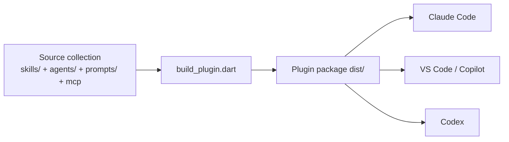
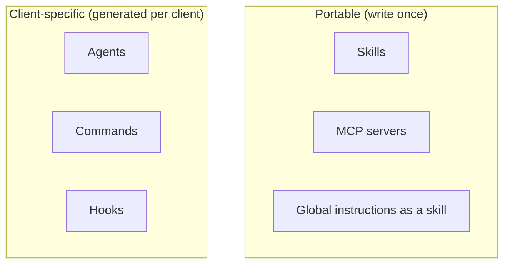
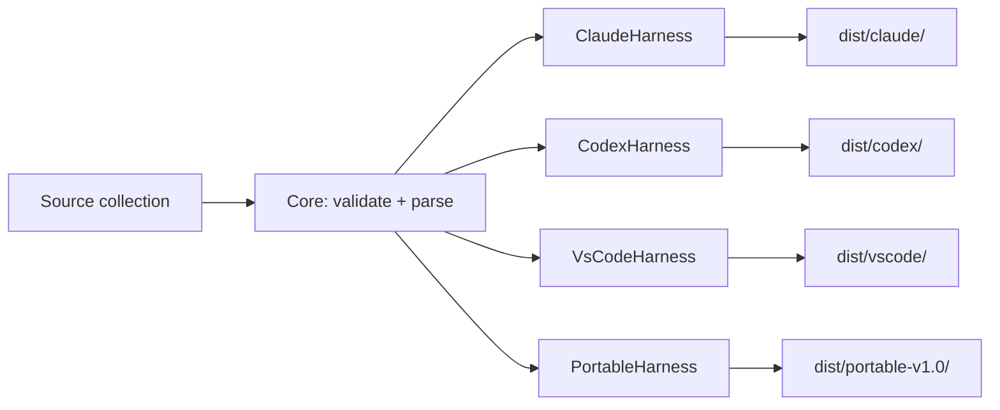

# Cross-platform plugin packaging

How to package a collection of skills, agents and prompts **once** and load it
as a plugin in Claude Code, GitHub/VS Code Copilot, and OpenAI Codex — without
maintaining a separate copy per client.

This is a generic recipe. It is written so it can be applied to **any** source
collection, not just this repository. Two collections are used as worked
instances:

- **Instance A** — this repository (Dart/Flutter skills, agents and global
  prompts). Source lives in-tree.
- **Instance B** — a private work collection (skills plus a private MCP server).
  Its source lives outside this repository and is git-ignored; see
  [§ No work identifiers on origin](#no-work-identifiers-on-origin).

Distribution is **local-only**: plugins are built into a `dist/` tree and loaded
from disk or a local marketplace. Nothing here publishes to a public
marketplace.

## Goals

- One canonical source per collection; no triplication per client.
- A single, generic build step (`build_plugin.dart`) that turns a source
  collection into a plugin package loadable by all three clients.
- A clear split between what is portable and what is client-specific, so the
  portable core is written once and only the client-specific parts are
  generated.

## Non-goals

- Publishing to any public directory or marketplace.
- Packaging commands, hooks, monitors, themes, or workflows (out of scope for
  v1; the model below leaves room for them).
- A GUI. The build step is a CLI.

## The portable model

Every client's plugin format is a directory. The overlap between them is small
but real: **skills** and **MCP servers** are portable; **agents**, commands and
hooks are client-specific.



A **source collection** is a directory that contains:

| Entry | Meaning | Required |
| --- | --- | --- |
| `skills/<name>/SKILL.md` | One directory per skill (open Agent Skills format) | at least one of skills/agents/prompts |
| `agents/*.md` | Agent definitions (canonical, client-neutral frontmatter) | optional |
| `prompts/AGENTS.md` | Global instructions to ship as a skill | optional |
| an MCP config file | Servers to bundle (`.mcp.json` / `mcp.json`) | optional |

The **generator** reads that collection and emits a **plugin package**: one
directory with a portable manifest plus the client-specific manifests and
component folders each client needs.

## Platform reference

### Manifests and detection

| Client | Primary manifest | Also reads | Notes |
| --- | --- | --- | --- |
| Agent Plugins 1.0 (portable) | `plugin.json` at root, with `"$schema": "https://agent-plugins.org/schemas/1.0.0/plugin.schema.json"` | — | Vendor-neutral standard (skills + MCP only) |
| Claude Code | `.claude-plugin/plugin.json` | — | Manifest optional; only `name` required |
| Codex | root `plugin.json` (portable) | `.codex-plugin/plugin.json` (compat overlay), `.claude-plugin/plugin.json`, `.claude-plugin/marketplace.json` | Portable package is the recommended form |
| VS Code / Copilot | root `plugin.json` (Agent Plugins, if it declares the schema) | `.claude-plugin/plugin.json` (Claude format), `plugin.json` (Copilot format), `.plugin/plugin.json` (legacy) | Format auto-detected from the root/format-specific manifest |

### Component locations

| Component | Portable (Agent Plugins) | Claude Code | VS Code (Copilot namespace) |
| --- | --- | --- | --- |
| Skills | `skills/<name>/SKILL.md` | `skills/<name>/SKILL.md` | `skills/` |
| MCP servers | `mcp.json` | `.mcp.json` | `mcp.json` |
| Agents | client-specific namespace | `agents/*.md` (subfolders OK) | `com.github.copilot/agents/*.agent.md` |
| Hooks | `com.<client>/hooks/hooks.json` | `hooks/hooks.json` | `com.github.copilot/hooks/hooks.json` |
| Global instructions | ship as a skill | ship as a skill (a root `CLAUDE.md` is **not** loaded) | ship as a skill |

> [!IMPORTANT]
> Claude Code does not load a `CLAUDE.md` at the plugin root as context (its
> validator warns about it). Global instructions must be shipped as a **skill**,
> e.g. `skills/global-instructions/SKILL.md`. This is also the only portable way
> to ship them, since Codex and VS Code have no equivalent "plugin root
> instructions" file either.

### Marketplaces (local)

| Client | Marketplace file | Local add |
| --- | --- | --- |
| Claude Code | `.claude-plugin/marketplace.json` at the marketplace root (emitted) | `claude --plugin-dir dist/claude/<name>` (no marketplace needed), or `claude plugin marketplace add ./dist/claude` then `claude plugin install <name>@<marketplace>` |
| Codex | `.agents/plugins/marketplace.json` at the marketplace root (emitted); legacy `.claude-plugin/marketplace.json` | `codex plugin marketplace add ./dist/codex` then `codex plugin add <name>@<marketplace>` |
| VS Code | `chat.plugins.marketplaces` setting (git sources) | point at a local folder via the plugin locations setting |

### Load & verify

| Client | Load locally | Validate |
| --- | --- | --- |
| Claude Code | `claude --plugin-dir dist/claude/<name>` | `claude plugin validate dist/claude/<name>` (authoritative) |
| Codex | `codex plugin marketplace add ./dist/codex` then install | `codex plugin marketplace list` |
| VS Code | enable `chat.plugins.enabled`, then add the folder as a plugin location | Plugins page in the Agent Customizations editor |

### Environment variables (plugin root token)

| Format | Token | Env var |
| --- | --- | --- |
| Agent Plugins / Copilot | `${PLUGIN_ROOT}` | `PLUGIN_ROOT` |
| Claude | `${CLAUDE_PLUGIN_ROOT}` | `CLAUDE_PLUGIN_ROOT` |
| Codex (compat) | `${PLUGIN_ROOT}` (also sets `CLAUDE_PLUGIN_ROOT`) | `PLUGIN_ROOT`, `PLUGIN_DATA` |

## Portability tiers



**Compatibility matrix** (source artifact → client support):

| Source artifact | Claude Code | VS Code / Copilot | Codex | Strategy |
| --- | --- | --- | --- | --- |
| `skills/` | ✅ native | ✅ native | ✅ native | copy as-is |
| MCP config | ✅ `.mcp.json` | ✅ `mcp.json` | ✅ `mcp.json` | emit both files |
| `prompts/AGENTS.md` | ✅ as a skill | ✅ as a skill | ✅ as a skill | wrap as a skill |
| `agents/*.md` | ✅ `agents/` | ⚠️ via `com.github.copilot/` | ⚠️ not a plugin component | translate (see below) |
| commands | ✅ `commands/` | client-specific | client-specific | deferred |
| hooks | ✅ `hooks/hooks.json` | `com.github.copilot/hooks/hooks.json` | `hooks/hooks.json` | deferred |

### Agent translation

The source `agents/*.md` are canonical, client-neutral definitions: Markdown with
YAML frontmatter (`name`, `description`, `tools`, `model`, `effort`) plus a body
that is the system prompt. The generator emits one file per target.

| Canonical field | Claude | Copilot | Codex |
| --- | --- | --- | --- |
| `name` | `name` (kebab-case slug) | `name` | `name` |
| `description` | `description` | `description` | `description` |
| `tools` | `tools` (comma-separated, names unchanged) | `tools` (YAML list, aliased — see below) | *(none — Codex agents inherit the parent's tools)* |
| `model` | `model` | *(omitted)* | *(omitted — Codex `model` takes a Codex slug, not `sonnet`)* |
| `effort` | `effort` | `reasoning-effort` | `model_reasoning_effort` |
| body | system prompt | system prompt | `developer_instructions` |

Fields the source carries that are **dropped**: opencode-only `mode`
(`primary`/`subagent`) and `permission` (edit/bash/webfetch allow/deny/ask);
Claude's plugin agents ignore the latter anyway and have no equivalent of the
former. `name` values containing spaces are slugified (`test writer` →
`test-writer`) so they match the file name and every client's identifier rules.

Tool-name mapping for Copilot (Claude-style names → Copilot's coarse aliases;
tokens with no Copilot equivalent — `Skill`, `SendMessage`, `ListAgents` — are
dropped, and MCP tools collapse to `<server>/*`):

| Canonical | Copilot |
| --- | --- |
| `Read` | `read` |
| `Grep`, `Glob` | `search` |
| `WebFetch`, `WebSearch` | `web` |
| `Write`, `Edit` | `edit` |
| `Bash` | `execute` |
| `Agent` | `agent` |
| `TodoWrite` | `todo` |
| `mcp__<server>__<tool>` | `<server>/*` |

> [!NOTE]
> **Codex has no plugin-provided agents component.** Codex reads custom agents
> only from `~/.codex/agents/*.toml` (user scope) and `.codex/agents/*.toml`
> (project scope, trusted projects). The generator therefore writes Codex agents
> to `.codex/agents/*.toml` *inside the package* as a convenience, but a Codex
> user must copy or symlink them into their own `.codex/agents/` for Codex to
> load them. Required TOML keys: `name`, `description`, `developer_instructions`.

## The generator

A single generic Dart CLI, `build_plugin`, living in the `plugin_builder/`
project of this repository (`plugin_builder/bin/build_plugin.dart`, logic in
`plugin_builder/lib/`). It takes a source collection and writes a plugin
package.

### Contract

```sh
dart run plugin_builder:build_plugin \
  --source <dir>          # source collection root (holds skills/)
  --name <plugin-name>    # kebab-case plugin id
  [--out <dir>]           # output directory, default dist; one folder per target inside
  [--targets a,b]         # harness ids; default: all (see --list-targets)
  [--list-targets]        # print the supported harnesses and exit
  [--agents <dir>]        # agent definitions (default: <source>/agents)
  [--prompts <file>]      # global instructions to wrap as a skill
  [--mcp <file>]          # MCP server config to bundle
  [--exclude a,b]         # skill dir names to leave out (every file mode)
  [--files tracked|unignored|all]   # which skill files ship (default tracked)
  [--version <semver>]    # default: 0.1.0
  [--description <text>] [--author <name>] [--repository <url>] [--license <id>]
  [--marketplace <name>] [--display-name <text>] [--category <text>]
  [--clean]               # wipe --out before writing
  [--verbose]
  [--help]
```

Or drive it from a config file:

```sh
dart run plugin_builder:build_plugin --config <file.json>
```

The config file holds the same fields under camelCase keys (`displayName`,
`files`, `targets`, ...). Relative paths in it resolve against the config's
directory; relative paths on the command line resolve against the working
directory.

**Precedence.** A flag given on the command line wins over the config file,
which wins over the default. A repeated option keeps its last value; list
options (`--targets`, `--exclude`) take commas and accumulate across repeats.
Unknown flags, missing values and stray arguments are usage errors.

**Exit codes.** `0` ok, `2` the source failed validation, `64` bad arguments
or a missing config or source.

The grammar lives in one `ArgParser` (`package:args`,
`plugin_builder/lib/src/options.dart`); `--help` is generated from it, so the
list above and the CLI cannot drift apart silently.

Instance A's config is committed (`plugin.config.json`); Instance B's config
and source paths are git-ignored.

### File selection

`--files` decides which files under `skills/` are candidates; `--exclude`
then removes whole skill folders, whatever the value.

| Value | Ships |
| --- | --- |
| `tracked` (default) | files git tracks, so git-ignored and untracked content never reaches a package |
| `unignored` | tracked files plus untracked files `.gitignore` does not ignore: package new, uncommitted work without pulling in ignored folders |
| `all` | every file on disk, ignored ones included |

Outside a git checkout every mode ships everything on disk. A file git lists
but that is gone from disk is skipped. A file directly in `skills/` (not in a
skill folder) is copied but never counted as a skill.

### Architecture: core plus harnesses

The core parses the source collection once (skills, agents, prompts, MCP
servers) and knows nothing client-specific. Each client is a **harness**: a
class implementing `Harness` (`plugin_builder/lib/src/harness.dart`) with an
`id` and an `emit(context)` method. Built-in harnesses live in
`plugin_builder/lib/src/harnesses/` (`claude`, `codex`, `vscode`, `portable-v1.0`)
and are listed in `builtInHarnesses`. Adding a client means writing one class
and adding it to that list; it then shows up as a `--targets` value, in
`--list-targets` (each harness supplies a one-line `description`) and as its own
output folder. Ids may carry a format version (`portable-v1.0`), so a later
version of a client's format can be added beside the old one.



### Responsibilities

Core, for every selected harness:

1. Validate the source collection (each skill has a `SKILL.md`; each skill's
   frontmatter `name`, when present, matches its directory; names are
   kebab-case) and the `--targets` ids.
2. Create `out/<id>/<plugin-name>/` and copy `skills/` verbatim into it
   (including supporting files and subdirectories).
3. Wrap `--prompts` into `skills/global-instructions/SKILL.md`.
4. Parse `agents/` and the MCP config once and hand them to the harness.
5. Report progress before each slow step; support `--verbose`.

Each harness, for its own client only:

| Harness | Writes |
| --- | --- |
| `claude` | `.claude-plugin/plugin.json`, `agents/*.md`, `.mcp.json`, `.claude-plugin/marketplace.json`, install scripts |
| `codex` | portable `plugin.json` + `mcp.json`, `.codex/agents/*.toml`, `.agents/plugins/marketplace.json`, install scripts |
| `vscode` | portable `plugin.json` + `mcp.json`, `com.github.copilot/agents/*.agent.md` |
| `portable-v1.0` | `plugin.json` + `mcp.json` only (no agents); the id carries the Agent Plugins format version |

Agents are translated per client; see [§ Agent translation](#agent-translation).
MCP config gets the required `type` field in the portable copy.

### Output layout

`dist/` holds one folder per harness. Each is a **marketplace root** with the
plugin package in a subdirectory, and is fully self-contained: it carries its
own copy of the skills, so one folder can be zipped or copied on its own. The
marketplace-root shape is what Codex's repo marketplace expects, and Claude/VS
Code simply point at the package subdirectory.

```text
dist/
├── claude/                             # marketplace root
│   ├── .claude-plugin/marketplace.json
│   ├── install.sh, install.ps1
│   └── <plugin-name>/                  # the plugin package
│       ├── .claude-plugin/plugin.json
│       ├── skills/                     # copied verbatim
│       │   ├── <skill>/SKILL.md
│       │   └── global-instructions/SKILL.md
│       ├── agents/*.md
│       └── .mcp.json                   # optional
├── codex/
│   ├── .agents/plugins/marketplace.json
│   ├── install.sh, install.ps1
│   └── <plugin-name>/
│       ├── plugin.json, mcp.json
│       ├── skills/
│       └── .codex/agents/*.toml        # copied to ~/.codex/agents by the installer
├── vscode/
│   └── <plugin-name>/
│       ├── plugin.json, mcp.json
│       ├── skills/
│       └── com.github.copilot/agents/*.agent.md
└── portable-v1.0/
    └── <plugin-name>/ (plugin.json, mcp.json, skills/)
```

### Install scripts

Harnesses with a CLI to install plugins write `install.sh` (POSIX `sh`) and
`install.ps1` (PowerShell) next to the marketplace root. A harness describes
its steps once (`RunCommand`, `CopyFiles`) and both scripts are rendered from
them; each step is announced before it runs, a missing CLI stops the script,
and a failing command stops it.

- `claude`: `claude plugin marketplace add <root>`, then
  `claude plugin install <name>@<marketplace>`.
- `codex`: copy `.codex/agents/*.toml` into `$CODEX_HOME/agents` (default
  `~/.codex/agents`), then `codex plugin marketplace add <root>` and
  `codex plugin add <name>@<marketplace>`.
- `vscode`: none; plugins are enabled through settings.

### MCP servers per client

The source MCP config is Claude-style (`{"mcpServers": {...}}`, or the map
itself). Each harness writes the file its client reads:

| Harness | File | Content |
| --- | --- | --- |
| `claude` | `.mcp.json` | `{"mcpServers": {...}}`, servers exactly as written |
| `codex`, `vscode`, `portable-v1.0` | `mcp.json` | Agent Plugins 1.0: `$schema` + `mcpServers`, servers converted as below |

The portable format is stricter than Claude's, so servers are converted, not
copied (`plugin_builder/lib/src/portable_mcp.dart`):

- `type` is required. `http` (Claude's alias) becomes `streamable-http`; a
  missing type is inferred (`url` means `streamable-http`, else `stdio`); `sse`
  and `stdio` are kept; `ws` and anything else cannot be expressed.
- `${CLAUDE_PLUGIN_ROOT}` / `${CLAUDE_PLUGIN_DATA}` become `${PLUGIN_ROOT}` /
  `${PLUGIN_DATA}`, but only in `args`, `env` values and `cwd`, the only places
  the format expands them. A leading `${CLAUDE_PLUGIN_ROOT}/` in `command`
  becomes `./`. A placeholder anywhere else (`url`, `headers`, elsewhere in
  `command`) is an error.
- `command` must be one bare executable name or a `./` plugin path: a shell
  string or another path is an error.
- Each variant is closed: a field it does not define (for example `envFile`)
  is an error, as is an `env` key named `PLUGIN_ROOT` or `PLUGIN_DATA`.

Anything that cannot be converted fails the build with exit code 2, listing
every problem of every server. It fails the `codex`, `vscode` and `portable-v1.0`
targets only; `claude` writes the same servers untouched. Output written by
earlier targets stays, so rerun with `--clean` after fixing the config.

What the clients' docs say (checked against the pages listed under References):

- Claude documents `.mcp.json` with the `mcpServers` wrapper (the wrapper is
  optional there), or servers inline in `plugin.json`. It does not say whether
  an empty `mcpServers` is valid; `claude plugin validate` accepts it.
- Agent Plugins 1.0: `mcp.json` at the plugin root, `$schema` and `mcpServers`
  required and nothing else at the top level, `type` required, empty
  `mcpServers` valid.
- Codex: portable `mcp.json` at the root (its scaffold also writes a
  Codex-style `.mcp.json`); its docs warn that the portable format also needs a
  `type` per server. Which placeholder Codex expands inside MCP paths is not
  documented.
- VS Code: `mcp.json` for Agent Plugins plugins, `.mcp.json` for Claude-format
  ones. The Copilot-format MCP file and empty-file validity are not documented.

`claude plugin validate` only checks the Claude package. The portable
`mcp.json` follows the specification text but is not validated by a tool.

### File access and testing

All file work goes through the analyzer's `ResourceProvider`: `BuildOptions`
holds `Folder` and `File` objects, harnesses write through `HarnessContext`,
and nothing else uses `dart:io` files. That lets the tests build into a
`MemoryResourceProvider` and assert exactly which files land where.

Two things still reach the host and are injected through `BuildEnvironment`:
the git file listing (`GitFilesLookup`) and `chmod +x` for `install.sh`
(`MakeExecutable`). Tests replace both with fakes.

What the tests pin down:

- the exact set of files under each `dist/<id>/` folder, so a stray or
  misplaced file fails;
- that nothing is written outside the output folder and the source is
  untouched;
- MCP config in each client's own file (`.mcp.json` for Claude, `mcp.json`
  elsewhere);
- only `install.sh` is marked executable;
- every `--files` mode, `--exclude`, `--clean`, validation failures that write
  nothing, config precedence and the command-line grammar;
- a custom harness plugging in without changes to the core;
- one run on the real file system and one against a real temporary git
  repository, covering the physical provider and `gitListFiles`.

## Instances

### Instance A — this repository

- Source: `skills/`, `agents/`, `prompts/AGENTS.md`.
- Committed config: `plugin.config.json` (name, version, author, source dirs).
- Ships **skills + prompts + agents** (agents in all three formats).
- Build (from `plugin_builder/`): `dart run plugin_builder:build_plugin --config ../plugin.config.json`.

### Instance B — private work collection

- Source: a work collection outside this repository (skills plus a private MCP
  server). **Never committed.**
- Its config, source paths, and MCP config live in git-ignored files.
- Exercises the MCP-bundling path end to end.
- Build (from `plugin_builder/`): `dart run plugin_builder:build_plugin --config <git-ignored config>`.

## No work identifiers on origin

**Rule.** No tracked file may contain a work identifier: the employer/vendor
name, product names, the ticket-system name, the private MCP server name,
technician codes, or work-skill names. These may appear **only** as ignore
patterns in `.gitignore`.

**This document obeys the rule.** Work items are described by category
("work collection", "private MCP server"), never named.

**Instance B mechanics.** The work collection's source, its generator config,
and its MCP config all live in git-ignored files. Only the generic generator and
this abstract recipe are on origin.

**Enforcement.**

- The forbidden-term list lives in a **git-ignored** config file
  (`.work-identifiers`), so the list itself is never committed.
- `check_no_work_refs` (`.githooks/check_no_work_refs.dart`) scans the
  tracked tree for any listed term and fails if it finds one. With no config
  present it no-ops with a notice.
- A pre-commit hook (`.githooks/pre-commit`) runs the same check against staged
  content. Activate it once with:

  ```sh
  git config core.hooksPath .githooks
  ```

  Bypass deliberately with `git commit --no-verify`.
- Run it by hand any time with:

  ```sh
  dart run .githooks/check_no_work_refs.dart   # from the repo root
  ```

## Phasing


- **Phase 0 — Spec.** This document.
- **Phase 1 — Origin hygiene.** Genericize the one leaking example; add the
  git-ignored term list, the check script, and the pre-commit hook.
- **Phase 2 — Generator (skills + prompts + MCP).** Implement
  `build_plugin.dart`; build and load Instances A and B on all three clients.
- **Phase 3 — Agents.** Normalize agent frontmatter (drop opencode's
  `mode`/`permission`); emit Claude, Copilot and Codex agent formats; document
  the tool-name mapping. Codex's agent format was the open research item: Codex
  plugins have **no** agent component, so Codex agents are written to
  `.codex/agents/*.toml` for the user to place themselves.
- **Phase 4 — Distribution polish.** Emit the Claude and Codex marketplace files
  at the marketplace root so `marketplace add ./dist` works; document the
  version-bump flow (edit `version` in the config, rebuild) and how to build and
  load each client in the repository README.
- **Phase 5 — Harness plug-ins.** Split the generator into a core and one
  `Harness` per client; write each client to its own self-contained folder
  under `dist/`; generate `install.sh`/`install.ps1` for the clients with an
  install CLI.
- **Phase 6 — Hermetic tests and CLI grammar.** Route all file access through
  `ResourceProvider` and test against an in-memory file system; parse flags with
  `package:args` (generated `--help`, config precedence, strict errors); add
  `--files` and make `--exclude` apply in every mode.

## References

- Agent Plugins 1.0 — <https://agent-plugins.org> (normative text: <https://agent-plugins.org/specification>)
- Agent Skills specification — <https://agentskills.io/specification>
- Claude Code plugins — <https://code.claude.com/docs/en/plugins>
- Claude Code plugin components — <https://code.claude.com/docs/en/plugins/components>
- Claude Code plugin manifest reference — <https://code.claude.com/docs/en/plugins/manifest-reference>
- Codex plugins — <https://developers.openai.com/codex/plugins/build>
- VS Code agent plugins — <https://code.visualstudio.com/docs/agent-customization/agent-plugins>
- VS Code agent plugin authoring reference — <https://code.visualstudio.com/docs/agents/reference/agent-plugin-reference>
